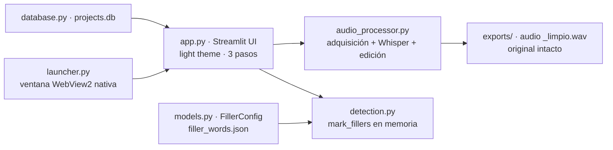

# AGENTS.md
This file provides guidance to Verdent when working with code in this repository.

## Table of Contents
1. Commonly Used Commands
2. High-Level Architecture & Structure
3. Key Rules & Constraints
4. Development Hints

## Commands
- Run the app in development: `.venv\Scripts\python.exe -m streamlit run app.py` (or `.venv\Scripts\python.exe launcher.py` for the native-window mode)
- No lint, formatter, or test suite is configured. Verification is manual via `demo_speech.wav` (short Spanish sample) and `_smoke_test.py`/`_e2e_test.py`-style throwaway scripts [inferred — earlier scripts no longer exist at root]
- Build portable (manual process):
  1. Copy changed sources to `EliminaMuletillas_Portable\app\` (`app.py`, `audio_processor.py`, `detection.py`, `models.py`, `database.py`, `filler_words.json`, `.streamlit\config.toml`)
  2. Recompile `launcher.py` → `EliminaMuletillas_Portable\EliminaMuletillas.exe` with PyInstaller (`--onefile --noconsole`), keeping `runtime\` (embedded Python 3.11 + site-packages) and `bin\` (ffmpeg) intact
  3. Verify with `EliminaMuletillas_Portable\EliminaMuletillas.exe`, then regenerate `EliminaMuletillas_Portable_Windows.zip` (≈470 MB, takes minutes)
- All shell work uses Windows `cmd` syntax (no POSIX-only tools)

## Architecture
- **`app.py`** — Single-page Streamlit UI in Spanish with a linear flow: Paso 1 upload → Paso 2 review (waveform + karaoke transcript + per-detection checkboxes) → Paso 3 export (folder picker + crossfade toggle). All state lives in `st.session_state`; light-theme CSS injected via `inject_theme()`.
- **`audio_processor.py`** — Audio layers: `read_header`/`load_audio` (acquisition, real header params), `transcribe_with_timestamps` (Whisper `word_timestamps=True`, ETA progress callback), `apply_filters` (frame-index cuts with 25 ms crossfade), `export_audio`, `generate_waveform_data` (peak decimation).
- **`detection.py`** — In-memory filler marking (`mark_fillers`, `normalize` with `unidecode`); supports multi-word phrases via regex on the joined normalized word sequence. Re-runs in milliseconds — Whisper is never re-called.
- **`models.py`** — `Project`, `WordTimestamp` dataclasses and thread-safe `FillerConfig` singleton persisting to `filler_words.json`.
- **`database.py`** — SQLite (`projects.db`) recording project metadata and export paths.
- **`launcher.py`** — Desktop launcher: starts Streamlit headless on a free port (8501–8560) and opens a native WebView2 window via pywebview; falls back to the browser; errors go to `launcher.log`.

## Key Rules & Constraints
- **Zero hardcoding in audio**: `sample_rate`/`channels`/`bit_depth` must come from the real file header (`read_header`), never assumed; MP3/M4A/OGG convert to WAV in memory via pydub (needs ffmpeg on PATH — `bin\` in the portable).
- **Filler list is user-editable** (`filler_words.json`, `{"fillers": [...]}`) — never hardcode phrases in code; `models.DEFAULT_FILLERS` is only the first-run seed. Changing the list must only re-run `mark_fillers`, never re-transcribe.
- **No full audio in RAM**: cuts by frame indices/slices, waveform by decimation (~1000 peaks) — must survive 2 GB / 6-hour sessions.
- **Smooth cuts**: every removal applies a 25 ms crossfade by default (`DEFAULT_CROSSFADE_MS`); the original file is never modified, exports go to a new file.
- **Failure tolerance**: segments Whisper can't transcribe become `[No transcrito]` with `will_remove=False` — never auto-deleted.
- **UI**: light mode only (user mandate — dark mode rejected); all UI text in Spanish; unique Streamlit widget keys (duplicate-key crashes are a recurring failure); do not assign widget-bound keys via `st.session_state` (raises `StreamlitValueAssignmentNotAllowedError`).
- **Packaging invariant**: `runtime\` and `bin\` in the portable must not be deleted/renamed; `python311._pth` must not be modified; the exe must not open a browser by itself (`--server.headless true`).
- **GIT — MANDATORY RULE**: NEVER run `git add`, `git commit`, `git push` (nor force-push, branch deletion, or any operation that publishes or mutates the repository history) without the user's explicit authorization. The user must approve the exact scope of what is committed/pushed each time. This project uses `.gitignore` to keep `.venv/`, `EliminaMuletillas_Portable/`, `*.zip`, `build/`, `uploads/`, `exports/`, `projects.db` and other runtime artifacts out of the repository — never add them with `git add -f`.
- UI code contains a tricky whisper hook: `whisper.transcribe` is shadowed by the package-level function, so `audio_processor.py` loads the module via `importlib.import_module("whisper.transcribe")` and swaps its `tqdm` module for a progress wrapper — do not "simplify" this without retesting progress reporting.

## Development Hints
- **Adding a filler phrase**: edit `filler_words.json` or use the sidebar UI (adds/removes persist immediately and re-mark existing transcriptions without re-transcription).
- **Changing Whisper model**: options live in the `model_labels` dict in `app.py` sidebar (`tiny`/`small`/`medium`); `load_model` is `lru_cache`d. First run of a new model downloads it (~460 MB).
- **New audio formats**: pydub+ffmpeg handle most; extend `read_header` only if a format can't be decoded.
- **Export flow changes**: Paso 3 block in `app.py` — folder picker (`_browse_folder`, tkinter), quick-location selectbox (key `quick_loc`, applied via `_applied_quick` guard), and `export_dir_input` text input.
- **Debugging the packaged app**: check `launcher.log` next to the exe; if the browser opens instead of the native window, WebView2 Runtime is missing (see portable `LEEME.txt`).
- **DB changes**: schema lives in `database._SCHEMA` (idempotent `executescript`); existing `projects.db` must stay compatible.
