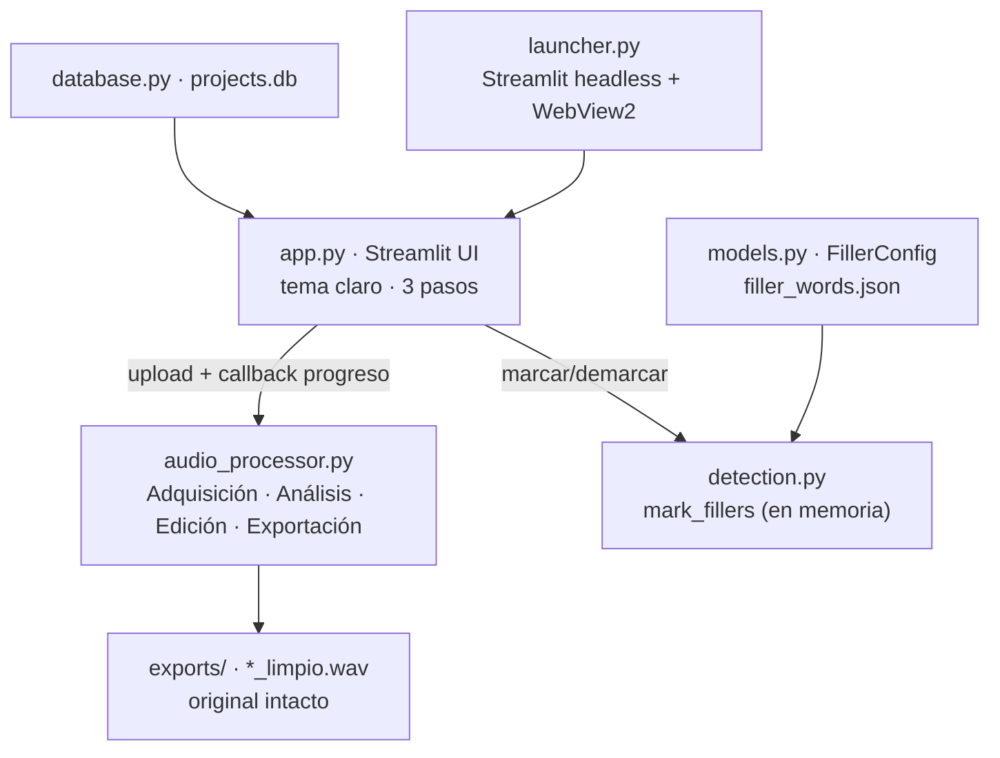
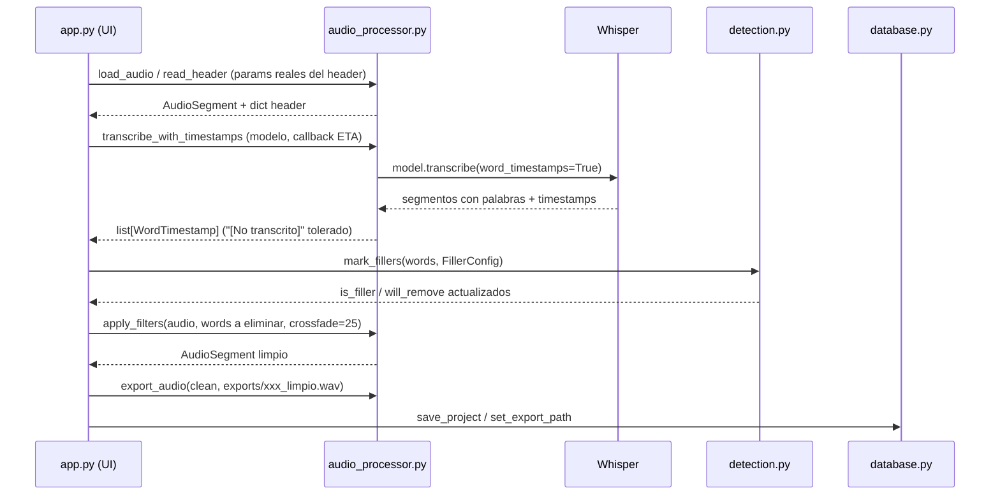

# Arquitectura — EliminaMuletillas

Editor/automatizador de audio para Windows que detecta y elimina muletillas en castellano, con transcripción sincronizada para auditoría visual.

## Visión general

Aplicación de escritorio local con arquitectura en capas: la UI (Streamlit) nunca procesa audio directamente; delega en módulos especializados. Todo el estado de la sesión vive en `st.session_state`; la persistencia es local (SQLite + JSON).



## Módulos

| Módulo | Responsabilidad | Entrada → Salida |
|---|---|---|
| `app.py` | Única capa de presentación. Flujo lineal: Paso 1 subir → Paso 2 revisar → Paso 3 exportar. Inyecta el tema claro (`inject_theme`). | Sesión Streamlit |
| `audio_processor.py` | 4 capas: **Adquisición** (`read_header`, `load_audio`), **Análisis** (`transcribe_with_timestamps`, Whisper `word_timestamps=True`), **Edición** (`apply_filters`, crossfade 25 ms), **Exportación** (`export_audio`) + decimación (`generate_waveform_data`). | Archivo → `list[WordTimestamp]` / `AudioSegment` |
| `detection.py` | Capa de Detección: `mark_fillers` marca `is_filler`/`will_remove` sobre los `WordTimestamp` ya transcritos. Normaliza con `unidecode` y soporta frases multi-palabra. | `list[WordTimestamp]` + config → mutación in-place |
| `models.py` | `Project`, `WordTimestamp` (dataclasses) y `FillerConfig` (singleton thread-safe que persiste en `filler_words.json`). | Configuración ↔ JSON |
| `database.py` | Persistencia SQLite (`projects.db`): metadatos de proyectos y rutas de exportación. Esquema idempotente (`_SCHEMA`). | Metadatos ↔ BD |
| `launcher.py` | Lanzador de escritorio: arranca Streamlit headless (puerto libre 8501–8560) y abre ventana nativa WebView2 (pywebview); fallback a navegador; errores en `launcher.log`. | Exe → servidor + ventana |

## Flujo de datos principal



## Flujo de la UI (los 3 pasos)

1. **Paso 1 — Subir**: `st.file_uploader` guarda en `uploads/`, lee el header real, botón "Empezar el análisis" → Whisper con `st.progress` + ETA → `mark_fillers` → `generate_waveform_data`.
2. **Paso 2 — Revisar**: forma de onda Plotly con `vrect` por estado (rojo=eliminar, verde=conservar, gris=sin transcribir) y línea del tiempo actual; clic = seek. Karaoke HTML con clases `.f`, `.active`, `.ignored`, `.nt`. `st.data_editor` con checkbox "quitar" por detección (columna oculta `_idx` para aplicar cambios). Slider de tiempo para sincronizar el karaoke.
3. **Paso 3 — Guardar**: selector de ubicación rápida (`quick_loc` + guarda `_applied_quick`), botón "Explorar carpetas..." (tkinter `_browse_folder`), input de ruta (`export_dir_input`), checkbox "Suavizar los cortes" (crossfade 25 ms o 0). Exporta `{stem}_limpio.wav` y registra en SQLite.

## Estado de sesión (claves de `st.session_state`)

| Clave | Tipo | Propósito |
|---|---|---|
| `config` | `FillerConfig` | Singleton de muletillas |
| `project` | `Project \| None` | Metadatos del proyecto actual |
| `audio` | `AudioSegment \| None` | Audio cargado (en memoria) |
| `words` | `list[WordTimestamp] \| None` | Transcripción + marcado |
| `wave_data` | `list[float] \| None` | Onda decimada (~1000 puntos) |
| `current_time` | `float` | Cursor de reproducción/karaoke |
| `last_export` | `str \| None` | Ruta del último audio exportado |

Widgets con clave propia (¡claves únicas obligatorias!): `cb_{frase}` (sidebar), `new_filler_input`, `waveform_chart`, `filler_editor`, `quick_loc`, `export_dir_input`.

## El hook de Whisper (trampa importante)

`whisper.transcribe` es **una función** (el `__init__.py` del paquete la exporta), no el módulo. Por eso `audio_processor.py` hace:

```python
_whisper_transcribe = importlib.import_module("whisper.transcribe")
```

y sustituye `_whisper_transcribe.tqdm` por un módulo fake (`_fake_tqdm_module`) cuya clase `_ProgressTqdm` reporta el progreso a la UI. No refactorizar sin retestar la barra de progreso.

## Empaquetado portable

```
EliminaMuletillas_Portable/
├── EliminaMuletillas.exe   # launcher.py compilado (PyInstaller --onefile --noconsole)
├── app/                    # código fuente: app.py, audio_processor.py, ... + filler_words.json
├── runtime/                # Python 3.11 embebido + site-packages (no tocar python311._pth)
├── bin/                    # ffmpeg / ffprobe
├── .streamlit/config.toml  # tema claro + headless
├── LEEME.txt               # instrucciones para el usuario final
└── launcher.log            # diagnóstico (se genera en ejecución)
```

El launcher añade `bin\` y `runtime\` al `PATH` y arranca `runtime\python.exe -m streamlit run app\app.py` con `--server.headless true`. La ventana WebView2 se abre con pywebview; si falta el Runtime, fallback al navegador.

## Decisiones de arquitectura

Registradas en `docs/decisions/` (ADR):

- `001-database.md` — SQLite + `filler_words.json`
- `002-native-window-launcher.md` — Ventana nativa sin navegador
- `003-portable-packaging.md` — Distribución portable
